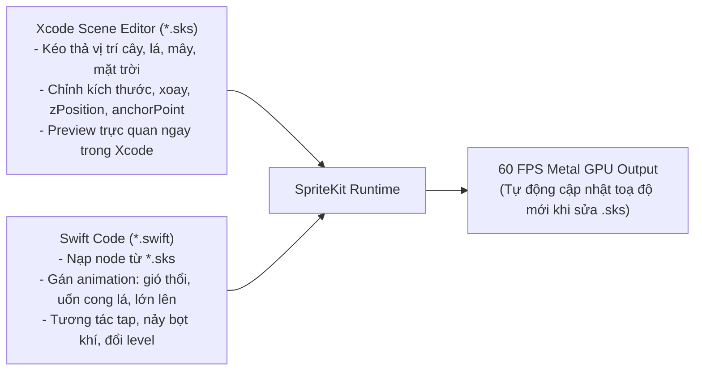

# Quy chuẩn Cấu trúc Asset & Hoạt ảnh Cây (Plant Asset Convention)

Áp dụng cho tất cả các loài cây (`Plant1`, `Plant2`, `Plant3`,...) trong dự án `terrariumidle_ios`. Lấy `Plant1` làm chuẩn kiến trúc.

## 1. Phân bổ và Đánh số Asset (Asset ID Naming Convention)

Khi cấu hình asset trong `Assets.xcassets/Plants/<plant_folder>/` (Ví dụ `plant2/` sử dụng tiền tố `plant2_Asset-...` hoặc tên đặc thù theo yêu cầu):

| Asset ID | Tên Asset (`plantX_...`) | Vai trò & Mục đích | Cơ chế hoạt động & Quy tắc sử dụng |
| :--- | :--- | :--- | :--- |
| **`Asset-1` / Avatar** | `plantX_Asset-1` (hoặc `aloe-vera@4.167x`) | **Ảnh đại diện tĩnh (Avatar / Reference)** | **KHÔNG** đưa vào làm hiệu ứng chuyển động trong Scene SpriteKit. Chỉ dùng làm ảnh đại diện (avatar/thumbnail/store preview) hoặc làm ảnh tham chiếu (reference canvas) để đối chiếu tọa độ pixel, anchor point, scale khi dựng hoạt ảnh. |
| **`Asset-2` -> `Asset-99`** | `plantX_Asset-2`... | **Thành phần hoạt ảnh động (Animated Parts)** | Các bộ phận cấu tạo nên cây trưởng thành (Level 3+): các phiến lá, cuống, cành cây, bông hoa. Mỗi phần tử được render riêng biệt qua SpriteKit `SKSpriteNode` với điểm neo (`anchorPoint`) tại cuống/gốc và chạy hiệu ứng uốn lượn, lay động mềm mại trong gió (`SKAction.rotate(toAngle:)`, `scaleY`). Khi ghép toàn bộ các asset này lại sẽ tạo thành một cây hoàn chỉnh mà không cần `Asset-1`. |
| **`Asset-100`** | `plant1_Asset-100` | **Gieo hạt (Seed Stage - Level 1)** | Hiển thị trạng thái hạt giống trong đất hoặc mầm vừa nhú. Ánh xạ tái sử dụng từ Plant 1. Kèm hiệu ứng thở nhẹ / nảy mầm khi người chơi chạm vào (`tapSquashStretch`). |
| **`Asset-200`** | `plant1_Asset-200` | **Cây con (Sprout Stage - Level 2)** | Hiển thị trạng thái cây con 2 mầm lá non. Ánh xạ tái sử dụng từ Plant 1. Kèm hiệu ứng lắc lư đung đưa (`swayAction`) và nhún nhẹ (`bobAction`). |

---

## 2. Mô hình Kiến trúc Lai: Visual `.sks` + Swift Code Animation (BẮT BUỘC ĐẦY ĐỦ 3 FILE)

Mỗi loài cây mới `PlantX` bắt buộc phải có folder `Plants/PlantX/` chứa đầy đủ:
1. `PlantXScene.sks`
2. `PlantXNode.swift`
3. `PlantXView.swift`



### Yêu cầu cấu trúc file `.sks`:
- Kích thước scene đúng bằng kích thước ảnh tham chiếu (ví dụ: Plant1: 428x862, Plant2: 484x641, Plant3: 796x538), `anchorPoint = (0.5, 0.0)`.
- **Tự fill Asset vào mọi Sprite**: Mọi `SKSpriteNode` (`seedSprite`, `sproutSprite`, `leaf_X`) trong `.sks` **BẮT BUỘC PHẢI CÓ TEXTURE THẬT** (`imageNamed: ...`) tương ứng trong `Assets.xcassets`. Tuyệt đối không để `_texture = nil / $null` hoặc `color: .clear` khiến Xcode Scene Editor hiển thị khung chữ nhật rỗng.
- 3 nhóm node chuẩn:
  - `seedNode` (pos: (0, 0)) -> child `seedSprite` (pos: (0, -18.5), anchor: (0.5, 0.05), zPos: 10, texture: `plant1_Asset-100@4.167x`)
  - `sproutNode` (pos: (0, 0)) -> child `sproutSprite` (pos: (0, -18.5), anchor: (0.5, 0.05), zPos: 10, texture: `plant1_Asset-200@4.167x`)
  - `matureNode` (pos: (0, -10)) -> chứa các phiến lá con `leaf_1`, `leaf_2`,... sắp xếp đúng z-order (từ lớp sau ra trước), toạ độ cuống cắm vào chậu.

---

## 3. Quy tắc triển khai Code SpriteKit (`PlantXNode.swift`)

1. **SKS Scene Loader cho CẢ 3 TRẠNG THÁI (Seed, Sprout, Mature)**:
   - Khai báo hàm `loadSceneTemplate() -> SKScene?` nạp `PlantXScene.sks`.
   - Cả 3 hàm `buildSeedState` (Level 1), `buildSproutState` (Level 2) và `buildMatureState` (Level 3+) **BẮT BUỘC** phải ưu tiên nạp trực tiếp node tương ứng (`seedNode`, `sproutNode`, `matureNode`) từ `PlantXScene.sks`.
   - Tuyệt đối **KHÔNG ĐƯỢC** hardcode toạ độ Y của hạt giống/cây con bằng công thức như `containerSize.height * 0.08` làm trôi lệch vị trí và khiến cây con bay lơ lửng trên không trung.
   - Luôn có kiểm tra fallback tự fill texture: `if sprite.texture == nil { sprite.texture = loadTexture(...) }`.
   - Khi chỉnh vị trí trong Xcode Scene Editor (`.sks`), code Swift phải tự động sử dụng vị trí mới đó mà không cần sửa code.

2. **Cơ chế Fallback Procedural**:
   - Luôn định nghĩa `leavesMetadata` chuẩn để nếu file `.sks` chưa tải được thì code vẫn render chính xác 100% hình thể cây.

3. **Quy chuẩn Hiệu ứng Bọt khí Oxy (Oxygen Bubbles Convention - Lấy Plant 1 làm chuẩn)**:
   - **Thêm trực tiếp vào Node cây**: Bọt khí phải được add trực tiếp vào chính Node cây (`addChild(bubble)`), **TUYỆT ĐỐI KHÔNG** add vào `plantRootNode` vì `plantRootNode` bị `setScale(baseScale)` (thường thu nhỏ 0.2 ~ 0.25) khiến bọt khí bị teo nhỏ và không bay được ra khắp khung hình.
   - **Điểm sáng phản chiếu (Specular Highlight)**: Thêm node con `highlight` màu trắng (radius bằng 30% bọt, alpha 0.8) tạo hiệu ứng bọt khí 3D căng bóng.
   - **Kích thước và số lượng**:
     - Hạt giống (Lv.1): 1 - 2 bọt nhỏ (radius 1.8 - 3.0 pt).
     - Cây con (Lv.2): 3 - 4 bọt vừa (radius 2.2 - 3.8 pt).
     - Trưởng thành (Lv.3+): 8 - 12 bọt dồi dào (radius 3.5 - 7.5 pt).
   - **Vị trí sinh bọt**: Phân bổ từ các vị trí phiến lá ngẫu nhiên (`randomLeaf.parent?.convert(randomLeaf.position, to: self)`) hoặc trải đều tự nhiên khắp khung cây ($-44\% \dots +44\%$ chiều rộng, $18\% \dots 90\%$ chiều cao) với quãng đường bay $60 \dots 115\text{pt}$ và độ giãn nở `scaleUp: 1.30`.
   - **Thân cọc/trụ leo**: Nếu cây có cọc gỗ hoặc thân chính riêng (`assetId: 2`), không được lắc độc lập làm rời cuống lá khỏi cành; thân chính chỉ đung đưa rất nhẹ ($0.003 \dots 0.008\text{rad}$).

4. **Quy chuẩn Chống Trôi Góc & Xoay Lật 180 Độ (Anti-Rotation Drift Convention - BẮT BUỘC TUÂN THỦ)**:
   - **CẤM TUYỆT ĐỐI DÙNG `SKAction.rotate(byAngle:)`**: Trong cả hiệu ứng chạm (`PlantMotionEffect`) và hiệu ứng gió lay nghỉ (`addIdleSwayAnimation`) của cành, lá, thân hay gốc cây.
     * *Nguyên nhân*: `rotate(byAngle:)` tính xoay tương đối. Khi chạm liên tục (spam tap), chuỗi animation cũ bị ngắt giữa chừng qua `removeAction` trước khi kịp quay về, chuỗi mới cộng dồn góc xoay. Tích luỹ qua nhiều lần chạm khiến góc xoay lệch dần tới $180^\circ$ ($\pi\text{ rad}$), làm lá hoặc cây bị úp ngược xuống chậu.
   - **BẮT BUỘC DÙNG `SKAction.rotate(toAngle:)` TÍNH THEO GÓC NGHỈ TUYỆT ĐỐI**:
     * Mọi chuyển động xoay phải tính dao động quanh góc nghỉ ban đầu: `SKAction.rotate(toAngle: restAngle ± delta, duration: ...)`.
   - **Ghi nhớ và khởi tạo `leaf.restZRotation`**:
     * Extension `SKNode.restZRotation` (trong `PlantMotionEffect.swift`) lưu trữ góc nghỉ ban đầu.
     * Khi khởi tạo bất kỳ phiến lá nào (`leaf_X`) trong `buildMatureState` (cả nhánh `.sks` lẫn procedural fallback), **BẮT BUỘC** gán:
       ```swift
       leaf.restZRotation = leaf.zRotation
       ```
   - **Reset góc nghỉ ngay đầu chuỗi tap action**:
     * Trong mọi `PlantMotionEffect`, ngay sau khi `leaf.removeAction(forKey:)` hoặc `root.removeAction(forKey:)`, **BẮT BUỘC** đưa góc xoay về vị trí nghỉ ngay lập tức:
       ```swift
       leaf.zRotation = leaf.restZRotation
       root.zRotation = 0.0
       ```
   - **Chốt chặn phục hồi ở cuối sequence**:
     * Chuỗi tap action luôn phải kết thúc bằng `SKAction.rotate(toAngle: restAngle)` kèm block chốt:
       ```swift
       SKAction.run { [weak leaf] in leaf?.zRotation = restAngle }
       ```
   - **Idle Sway Animation quanh `restZRotation`**:
     * Trong `addIdleSwayAnimation()`, lá phải đu đưa quanh `restZRotation`:
       ```swift
       let rest = leaf.restZRotation
       let swayRight = SKAction.rotate(toAngle: rest + swayAngle, duration: duration)
       let swayLeft  = SKAction.rotate(toAngle: rest - swayAngle, duration: duration)
       ```
   - **Debounce chống spam tap ở tầng Scene/View**:
     * Mọi Scene/View nhận touch tap (`SpriteKitPlantScene`, `TerrariumSlotView`) **BẮT BUỘC** có debounce tối thiểu 80ms (`CACurrentMediaTime() - lastTapTime < 0.08`) để ngăn bão sự kiện touch.

---

## 4. Bóc tách Toạ độ từ SVG & Công thức chuyển đổi SpriteKit (SVG Extraction & Coordinate Conversion)

Khi Designer hoàn thiện cây trên **Figma** hoặc **Adobe Illustrator**, họ có thể xuất một file `.svg` chứa toàn bộ các layer bộ phận cây (hoặc ảnh đặt đúng vị trí trên canvas). File SVG chứa các thẻ `<image>` hoặc layer `<g id="...">` với toạ độ top-left `(x, y)` và kích thước `(width, height)`.

### 4.1. Khác biệt hệ toạ độ giữa SVG và SpriteKit

| Tiêu chí | Hệ toạ độ SVG / Figma | Hệ toạ độ SpriteKit Scene (`PlantXScene`) |
| :--- | :--- | :--- |
| **Gốc toạ độ `(0, 0)`** | **Góc Trên - Trái** (Top-Left) | **Chính Giữa - Đáy chậu** (Bottom-Center, `anchorPoint = (0.5, 0.0)`) |
| **Trục X** | Hướng sang phải ($0 \rightarrow \text{canvasWidth}$) | Đối xứng qua tâm ($-\frac{\text{canvasWidth}}{2} \rightarrow +\frac{\text{canvasWidth}}{2}$) |
| **Trục Y** | Hướng **chúc xuống dưới** ($+Y$ đi xuống) | Hướng **chỉ lên trên** ($+Y$ đi lên trời) |

### 4.2. Công thức quy đổi chuẩn (Swift Code)

Cho một phiến lá trong file SVG có toạ độ `(svgX, svgY)`, kích thước `(width, height)` trên canvas `(baseCanvasWidth, baseCanvasHeight)` và điểm neo cuống lá `(anchorX, anchorY)`:

```swift
// 1. Trục X: Dịch mốc từ mép trái SVG sang tâm giữa SpriteKit
let skX = (svgX + anchorX * width) - (baseCanvasWidth / 2.0)

// 2. Trục Y: Lật ngược trục Y từ gốc đỉnh SVG sang gốc đáy SpriteKit (kèm offset cắm vào chậu ~10px)
let skY = baseCanvasHeight - svgY - (1.0 - anchorY) * height - 10.0
```

### 4.3. Quy chuẩn xác định Điểm Neo Cuống Lá (`anchorPoint`)

Điểm neo (`anchorPoint`) là vị trí gốc/cuống của phiến lá cắm vào thân hoặc chậu, dùng làm tâm xoay khi lá đung đưa trong gió (`SKAction.rotate`):
- **Lá hướng/nghiêng sang trái** (`isLeft: true`): Tâm cuống lá nằm ở góc dưới bên phải phiến lá $\rightarrow$ `anchorX ≈ 0.80 - 0.95`, `anchorY ≈ 0.00 - 0.05`.
- **Lá hướng/nghiêng sang phải** (`isLeft: false`): Tâm cuống lá nằm ở góc dưới bên trái phiến lá $\rightarrow$ `anchorX ≈ 0.05 - 0.20`, `anchorY ≈ 0.00 - 0.05`.
- **Lá mọc thẳng giữa**: Tâm cuống lá ở chính giữa đáy $\rightarrow$ `anchorX ≈ 0.50`, `anchorY ≈ 0.00`.

### 4.4. Tool tự động bóc tách và cập nhật Scene (`parse_plant_svg.py`)

Dự án cung cấp sẵn script bóc tách và cập nhật tự động tại:
`scripts/parse_plant_svg.py`

Cách chạy tự động theo Plant ID:
```bash
python3 .agent/skills/plant-asset-convention/scripts/parse_plant_svg.py --plant <X>
```

Hoặc chỉ định file SVG cụ thể:
```bash
python3 .agent/skills/plant-asset-convention/scripts/parse_plant_svg.py <path/to/plant.svg> --update [--offset-y 10.0]
```

Script sẽ tự động:
1. Đọc kích thước canvas và scale tương ứng với `baseCanvasWidth x baseCanvasHeight` của `PlantXNode.swift`.
2. Quét toàn bộ các phiến lá/bộ phận (cả thẻ `<image>` và vector `<g>/<path>`).
3. Tự động tính toán điểm neo cuống lá (`anchorPoint`) và toạ độ SpriteKit `(skX, skY)`.
4. Cập nhật trực tiếp vào file **`PlantXScene.sks`** và **`PlantXNode.swift`**.

### 4.5. Cơ chế Zero-Prompt Workflow (Quy trình tự động không cần Prompt dài)

- **Vị trí lưu trữ SVG**: File SVG xuất từ Figma / Illustrator luôn được đặt tại:
  `terrariumidle_ios/Resources/SVGPlants/plantX.svg`
- **Tác vụ khi người dùng chỉ ra lệnh ngắn** (ví dụ: *"từ plantX, sắp xếp lại toạ độ scene đi"*, *"sắp xếp lại toạ độ plant X từ file svg"*, hoặc tag `@plantX.svg`):
  1. Tự động lấy file `terrariumidle_ios/Resources/SVGPlants/plantX.svg`.
  2. Bóc tách toạ độ và quy đổi sang hệ toạ độ SpriteKit (`skX, skY`).
  3. Đồng bộ cập nhật vào cả `PlantXScene.sks` (toạ độ và điểm neo visual) và `PlantXNode.swift` (`leavesMetadata`).
  4. Chạy kiểm tra linting (`plutil -lint`) và Swift syntax (`swiftc -parse`).


