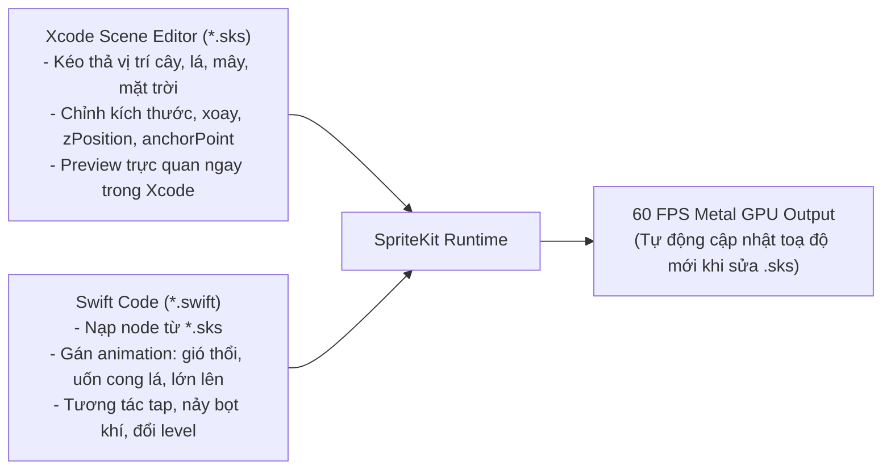

# Quy chuẩn Cấu trúc Asset & Hoạt ảnh Cây (Plant Asset Convention)

Áp dụng cho tất cả các loài cây (`Plant1`, `Plant2`, `Plant3`,...) trong dự án `terrariumidle_ios`. Lấy `Plant1` làm chuẩn kiến trúc.

## 1. Phân bổ và Đánh số Asset (Asset ID Naming Convention)

Khi cấu hình asset trong `Assets.xcassets/Plants/<plant_folder>/` (Ví dụ `plant2/` sử dụng tiền tố `plant2_Asset-...` hoặc tên đặc thù theo yêu cầu):

| Asset ID | Tên Asset (`plantX_...`) | Vai trò & Mục đích | Cơ chế hoạt động & Quy tắc sử dụng |
| :--- | :--- | :--- | :--- |
| **`Asset-1` / Avatar** | `plantX_Asset-1` (hoặc `aloe-vera@4.167x`) | **Ảnh đại diện tĩnh (Avatar / Reference)** | **KHÔNG** đưa vào làm hiệu ứng chuyển động trong Scene SpriteKit. Chỉ dùng làm ảnh đại diện (avatar/thumbnail/store preview) hoặc làm ảnh tham chiếu (reference canvas) để đối chiếu tọa độ pixel, anchor point, scale khi dựng hoạt ảnh. |
| **`Asset-2` -> `Asset-99`** | `plantX_Asset-2`... | **Thành phần hoạt ảnh động (Animated Parts)** | Các bộ phận cấu tạo nên cây trưởng thành (Level 3+): các phiến lá, cuống, cành cây, bông hoa. Mỗi phần tử được render riêng biệt qua SpriteKit `SKSpriteNode` với điểm neo (`anchorPoint`) tại cuống/gốc và chạy hiệu ứng uốn lượn, lay động mềm mại trong gió (`SKAction.rotateBy`, `scaleY`). Khi ghép toàn bộ các asset này lại sẽ tạo thành một cây hoàn chỉnh mà không cần `Asset-1`. |
| **`Asset-100`** | `plant1_Asset-100` | **Gieo hạt (Seed Stage - Level 1)** | Hiển thị trạng thái hạt giống trong đất hoặc mầm vừa nhú. Ánh xạ tái sử dụng từ Plant 1. Kèm hiệu ứng thở nhẹ / nảy mầm khi người chơi chạm vào (`tapSquashStretch`). |
| **`Asset-200`** | `plant1_Asset-200` | **Cây con (Sprout Stage - Level 2)** | Hiển thị trạng thái cây con 2 mầm lá non. Ánh xạ tái sử dụng từ Plant 1. Kèm hiệu ứng lắc lư đung đưa (`swayAction`) và nhún nhẹ (`bobAction`). |

---

## 2. Mô hình Kiến trúc Lai: Visual `.sks` + Swift Code Animation (BẮT BUỘC ĐẦY ĐỦ 3 FILE)

Mỗi loài cây mới `PlantX` bắt buộc phải có folder `Plants/PlantX/` chứa đầy đủ:
1. `PlantXScene.sks`
2. `PlantXNode.swift`
3. `PlantXView.swift`

### Yêu cầu cấu trúc file `.sks`:
- Kích thước scene đúng bằng kích thước ảnh tham chiếu (ví dụ: Plant1: 428x862, Plant2: 484x641, Plant3: 796x538), `anchorPoint = (0.5, 0.0)`.
- 3 nhóm node chuẩn:
  - `seedNode` (pos: (0, 0)) -> child `seedSprite` (pos: (0, 30), anchor: (0.5, 0.05), zPos: 10, texture: `plant1_Asset-100@4.167x`)
  - `sproutNode` (pos: (0, 0)) -> child `sproutSprite` (pos: (0, 20), anchor: (0.5, 0.05), zPos: 10, texture: `plant1_Asset-200@4.167x`)
  - `matureNode` (pos: (0, -10)) -> chứa các phiến lá con `leaf_1`, `leaf_2`,... sắp xếp đúng z-order (từ lớp sau ra trước), toạ độ cuống cắm vào chậu.

---

## 3. Quy tắc triển khai Code SpriteKit (`PlantXNode.swift`)

1. **SKS Scene Loader**:
   - Khai báo hàm `loadSceneTemplate() -> SKScene?` nạp `PlantXScene.sks`.
   - Trong `buildMatureState`: Ưu tiên nạp node từ `PlantXScene.sks` để đảm bảo khi người dùng chỉnh vị trí trong Xcode Scene Editor, giao diện tự động cập nhật mà không phải sửa code.

2. **Cơ chế Fallback Procedural**:
   - Luôn định nghĩa `leavesMetadata` chuẩn để nếu file `.sks` chưa tải được thì code vẫn render chính xác 100% hình thể cây.
