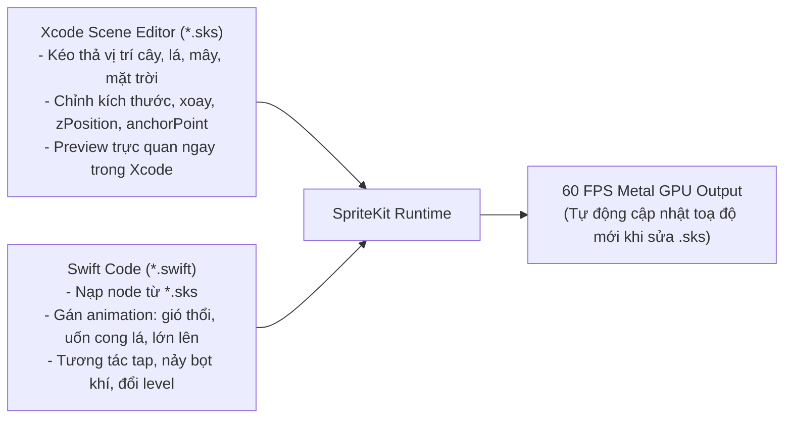

# Quy chuẩn Cấu trúc Asset & Hoạt ảnh Cây (Plant Asset Convention)

Áp dụng cho tất cả các loài cây (`Plant1`, `Plant2`,...) trong dự án `terrariumidle_ios`.

## 1. Phân bổ và Đánh số Asset (Asset ID Naming Convention)

Khi cấu hình asset trong `Assets.xcassets/Plants/<plant_folder>/` (Ví dụ `plant1/` sử dụng tiền tố `plant1_Asset-...`):

| Asset ID | Tên Asset (`plantX_...`) | Vai trò & Mục đích | Cơ chế hoạt động & Quy tắc sử dụng |
| :--- | :--- | :--- | :--- |
| **`Asset-1`** | `plant1_Asset-1` | **Ảnh nền / Ảnh đại diện tĩnh (Avatar / Reference)** | **KHÔNG** đưa vào làm hiệu ứng chuyển động trong Scene SpriteKit. Chỉ dùng làm ảnh đại diện (avatar/thumbnail/store preview) hoặc làm ảnh tham chiếu (reference canvas) để đối chiếu tọa độ pixel, anchor point, scale khi dựng hoạt ảnh. |
| **`Asset-2` -> `Asset-99`** | `plant1_Asset-2`... | **Thành phần hoạt ảnh động (Animated Parts)** | Các bộ phận cấu tạo nên cây trưởng thành (Level 3+): các phiến lá, cuống, cành cây, bông hoa. Mỗi phần tử được render riêng biệt qua SpriteKit `SKSpriteNode` với điểm neo (`anchorPoint`) tại cuống/gốc và chạy hiệu ứng uốn lượn, lay động mềm mại trong gió (`SKAction.rotateBy`, `scaleY`). Khi ghép toàn bộ các asset này lại sẽ tạo thành một cây hoàn chỉnh mà không cần `Asset-1`. |
| **`Asset-100`** | `plant1_Asset-100` | **Gieo hạt (Seed Stage - Level 1)** | Hiển thị trạng thái hạt giống trong đất hoặc mầm vừa nhú. Kèm hiệu ứng thở nhẹ / nảy mầm khi người chơi chạm vào (`tapSquashStretch`). |
| **`Asset-200`** | `plant1_Asset-200` | **Cây con (Sprout Stage - Level 2)** | Hiển thị trạng thái cây con 2 mầm lá non. Kèm hiệu ứng lắc lư đung đưa (`swayAction`) và nhún nhẹ (`bobAction`). |

---

## 2. Mô hình Kiến trúc Lai: Visual `.sks` + Swift Code Animation

Dự án áp dụng mô hình phân tách vai trò rõ ràng giữa **Thiết kế trực quan** và **Lập trình chuyển động**:

### Phân công trách nhiệm:
1. **Thiết kế trực quan (`*.sks` - Scene Editor)**:
   - Kéo thả bằng chuột trong Xcode để căn chỉnh vị trí `(x, y)`, góc xoay `rotation`, kích thước `scale`, thứ tự layer `zPosition` và điểm neo `anchorPoint` của từng lá, cành cây, đám mây, mặt trời.
   - Chia 3 nhóm node rõ ràng: `seedNode` (Hạt giống), `sproutNode` (Cây con), `matureNode` (Cây trưởng thành).
   - Designer hoặc lập trình viên có thể chỉnh sửa hình thể cây hoàn toàn bằng mắt và chuột trong Xcode mà không cần đụng đến code.

2. **Lập trình logic & hiệu ứng (`*.swift` - SpriteKit Code)**:
   - Tải các node từ file `.sks` thông qua tên nhóm (`seedNode`, `sproutNode`, `matureNode`) và tên các lá (`leaf_2` ... `leaf_19`).
   - Giữ nguyên tọa độ, góc xoay, layer mà file `.sks` đã sắp xếp. **Khi chỉnh sửa trong Xcode `.sks`, code Swift tự động sử dụng tọa độ mới đó, tuyệt đối không phải sửa lại tọa độ bằng tay trong code**.
   - Code Swift chỉ tập trung 100% vào logic và chuyển động:
     - Gió thổi uốn cong từng phiến lá (`SKAction.rotateBy`, `scaleX/Y`).
     - Cây đung đưa thân (`trunkSway`).
     - Tương tác chạm nhún nảy đàn hồi (`squash & stretch`) và sinh bọt khí oxy `+O2`.
     - Chuyển đổi trạng thái khi tăng level (`isHidden` giữa các nhóm).

3. **Xem trước độc lập (SwiftUI Canvas Preview & SKS Preview)**:
   - Xem trước giao diện tĩnh và toàn bộ chuyển động ngay trên **SwiftUI Preview** (`Plant1View.swift`) hoặc Play Animation trong `.sks` mà không cần chạy lại toàn bộ ứng dụng hay vào game.

---

## 3. Quy tắc triển khai Code SpriteKit (`PlantXNode.swift`)

1. **Trạng thái Trưởng thành (Level 3+)**:
   - Đọc trực tiếp các sprite lá từ `matureNode` trong file `.sks`.
   - Tuyệt đối **KHÔNG** add `Asset-1` vào scene hoạt ảnh vì nó là ảnh tĩnh đại diện và đối chiếu.
   - Tự động gắn hiệu ứng uốn cong `startLeafBendingAnimation` cho từng lá quanh điểm neo đã thiết lập.
   - Hỗ trợ cơ chế Fallback Procedural nếu file `.sks` chưa nạp đủ lá.

2. **Hệ tọa độ & Căn chỉnh (Alignment & Framing)**:
   - Toàn bộ cây và scene sử dụng hệ quy chiếu gốc đáy giữa: `anchorPoint = CGPoint(x: 0.5, y: 0.0)`.
   - Node gốc `plantRootNode.position = CGPoint(x: 0, y: isHanging ? containerSize.height : 0)`.
