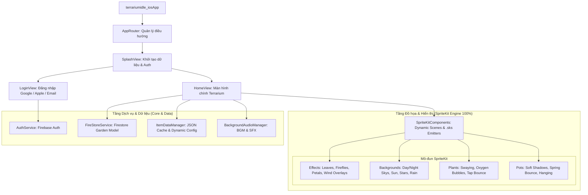
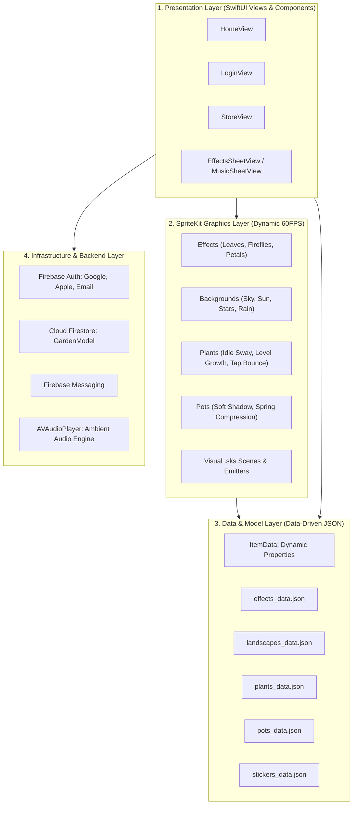
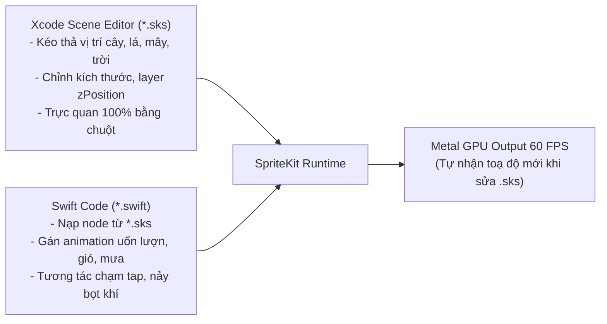
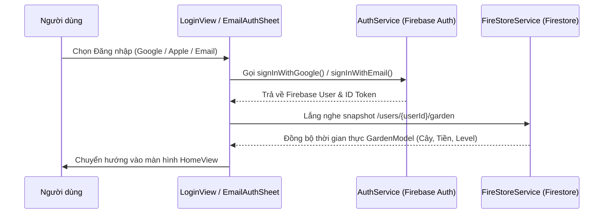

# 🌿 Terrarium Idle iOS

Dự án game mô phỏng thư giãn **Terrarium Idle** trên nền tảng iOS, xây dựng hoàn toàn bằng **SwiftUI**, **SpriteKit** và **Firebase**, kết hợp kiến trúc hướng thành phần (**Component-Driven**) và cơ chế cấu hình dữ liệu động (**Data-Driven Architecture**).

---

## 📑 Mục lục

1. [Tổng quan dự án](#-tổng-quan-dự-án)
2. [Sơ đồ kiến trúc phần mềm](#-sơ-đồ-kiến-trúc-phần-mềm)
3. [Cấu trúc thư mục mã nguồn](#-cấu-trúc-thư-mục-mã-nguồn)
4. [Hệ thống đồ họa SpriteKit](#-hệ-thống-đồ-họa-spritekit)
5. [Cơ chế cấu hình Data-Driven JSON](#-cơ-chế-cấu-hình-data-driven-json)
6. [Hệ thống Xác thực & Dữ liệu đám mây](#-hệ-thống-xác-thực--dữ-liệu-đám-mây)
7. [Hướng dẫn cài đặt & Biên dịch](#-hướng-dẫn-cài-đặt--biên-dịch)

---

## 📖 Tổng quan dự án

- **Nền tảng**: iOS 17.0+, iPhone & iPad
- **Ngôn ngữ**: Swift 5.10 / Swift 6 Compatible
- **Frameworks chính**:
  - `SwiftUI`: Giao diện người dùng Reactive, mượt mà.
  - `SpriteKit`: Hệ sinh thái đồ họa chính (100% thay thế Rive), phụ trách toàn bộ hiệu ứng lá rơi, đom đóm, mưa, cảnh nền trời/núi/mặt trời, chuyển động đung đưa & bong bóng oxy của cây, đổ bóng & nảy đàn hồi của chậu cây (60 FPS, Metal-accelerated).
  - `Firebase (Auth, Firestore, Messaging)`: Quản lý người dùng, đồng bộ dữ liệu khu vườn thời gian thực.
  - `AVFoundation`: Âm thanh nền (BGM), tiếng thời tiết (SFX) và hiệu ứng tương tác.
  - *(Lưu ý: Toàn bộ code Rive cũ đã được đóng comment lưu trữ lại trong thư mục `RiveCompoments` để làm tài liệu tham khảo, app không còn dùng Rive runtime nữa)*.

---

## 🏛️ Sơ đồ kiến trúc phần mềm

### 1. Sơ đồ luồng hoạt động tổng thể (System Workflow)



---

### 2. Sơ đồ phân tầng kiến trúc (Layered Architecture)



---

## 📁 Cấu trúc thư mục mã nguồn

```text
terrariumidle_ios/
├── Apps/
│   ├── Routers/
│   │   └── AppRouter.swift                  # Điều hướng các luồng màn hình chính
│   │
│   ├── Core/
│   │   ├── Services/
│   │   │   ├── AuthService.swift            # Xác thực Google, Apple, Email/Password
│   │   │   ├── AuthSession.swift            # Quản lý phiên đăng nhập
│   │   │   └── FireStoreService.swift       # Đồng bộ dữ liệu người dùng & khu vườn
│   │   ├── ViewModels/
│   │   │   ├── LoginViewModel.swift
│   │   │   └── AccountViewModel.swift
│   │   └── Utils/
│   │       ├── AudioPlayer.swift            # Phát âm thanh SFX
│   │       ├── BackgroundAudioManager.swift # Quản lý nhạc nền BGM luân chuyển
│   │       ├── MusicUnlockHelper.swift      # Kiểm tra mở khóa hiệu ứng/nhạc
│   │       └── FormatNumber.swift           # Định dạng số hiển thị tiền tệ
│   │
│   ├── Data/
│   │   ├── Models/
│   │   │   ├── ItemData.swift               # Model cấu hình động cho cây, chậu, sticker, effect, landscape
│   │   │   ├── GardenModel.swift            # Dữ liệu cây trồng, tiền tệ, cấp độ
│   │   │   └── UserModel.swift
│   │   └── Items/
│   │       ├── effects_data.json            # Cấu hình hiệu ứng lớp phủ (Overlays)
│   │       ├── landscapes_data.json         # Cấu hình bầu trời & phong cảnh (Landscapes)
│   │       ├── plants_data.json             # Danh sách cây cối & thuộc tính
│   │       ├── pots_data.json               # Danh sách chậu cây
│   │       ├── stickers_data.json           # Danh sách sticker & vật trang trí
│   │       ├── music_data.json              # Danh sách nhạc nền BGM
│   │       └── shop_items_data.json
│   │
│   ├── Compoments/
│   │   ├── SpriteKitComponents/             # ⭐️ Toàn bộ hệ thống đồ họa SpriteKit
│   │   │   ├── Effects/
│   │   │   │   ├── Leaves/                  # Lá rơi (Scene, View, FallingLeaves.sks)
│   │   │   │   ├── Fireflies/               # Đom đóm (Scene, View, Fireflies.sks)
│   │   │   │   └── Common/                  # OverlayEffectView, OverlayEffectConfig
│   │   │   ├── Backgrounds/
│   │   │   │   ├── Scenes/                  # SpriteKitBackgroundScene, BackgroundScene.sks
│   │   │   │   ├── Emitters/                # Rain.sks
│   │   │   │   └── Views/                   # SpriteKitBackgroundView
│   │   │   ├── Plants/
│   │   │   │   ├── Plant1/                  # 🌿 Cây Cỏ Loe ghép 18 lá (Plant1Node, Plant1View, Plant1Scene.sks)
│   │   │   │   ├── Scenes/                  # SpriteKitPlantScene, PlantScene.sks
│   │   │   │   └── Views/                   # SpriteKitPlantView
│   │   │   └── Pots/
│   │   │       ├── Scenes/                  # SpriteKitPotScene, PotScene.sks
│   │   │       └── Views/                   # SpriteKitPotView
│   │   │
│   │   ├── RiveCompoments/                  # Tích hợp RiveRuntime (.riv)
│   │   │   ├── RivePlantCompoment.swift
│   │   │   ├── RivePotCompoment.swift
│   │   │   └── RiveModel.swift
│   │   └── HomeCompoments/                  # Các giao diện con trang Home (SpeedDial, Sheets...)
│   │
│   └── Modules/
│       ├── Home/                            # Màn hình chính nuôi dưỡng Terrarium
│       ├── Auth/                            # Màn hình đăng nhập & Splash
│       └── Store/                           # Cửa hàng vật phẩm & trao đổi
│
└── Resources/
    ├── Rives/                               # File tài nguyên .riv cho background, cây, chậu
    ├── Images/                              # Ảnh minh họa
    └── Audio/                               # Nhạc nền & âm thanh hiệu ứng
```

---

## 🎨 Hệ thống đồ họa SpriteKit & Mô hình Kiến trúc Lai

Terrarium Idle áp dụng mô hình kiến trúc lai (**Hybrid Visual Architecture**): Kết hợp giữa **Visual Scene Editor (`*.sks`)** và **Swift Code (`*.swift`)**:

- **Kéo thả trực quan bằng chuột trong Xcode (`*.sks`)**: Thiết kế và căn chỉnh vị trí cây, lá, cuống, cành, mây, mặt trời, kích thước, góc xoay và thứ tự layer (`zPosition`).
- **Code Swift 100% cho Logic & Hoạt ảnh (`*.swift`)**: Đảm nhiệm mưa rơi, gió thổi, hiệu ứng lá uốn lượn mềm mại, cây lớn lên theo level, phản hồi vật lý khi chạm (`tap squash & stretch`), nhả bọt khí oxy `+O2`.
- **Tự động đồng bộ tọa độ**: Khi bạn kéo thả đổi vị trí hoặc xoay các bộ phận trong Xcode `.sks`, code Swift **tự động sử dụng vị trí mới đó**, không phải sửa lại tọa độ bằng tay trong code.
- **Xem trước độc lập (Isolated Preview)**: Xem trước giao diện tĩnh và toàn bộ chuyển động ngay trên **SwiftUI Canvas Preview** (ví dụ: `Plant1View.swift`) mà không cần chạy lại toàn bộ ứng dụng mỗi lần.



### Các module chính:

1. **Plants (Cây trồng đa trạng thái)**:
   - **File trực quan (`Plant1Scene.sks`)**: Chứa 3 nhóm node: `seedNode` (Hạt), `sproutNode` (Cây con), `matureNode` (18 lá cây trưởng thành `leaf_2`...`leaf_19`).
   - **Tự động uốn lượn**: Code Swift nạp 18 chiếc lá từ `.sks`, giữ nguyên vị trí được kéo thả và tự động gắn hiệu ứng uốn cong `startLeafBendingAnimation`.
   - **Quy ước Asset**:
     - `Asset-1` (`plant1_Asset-1`): Ảnh đại diện / đối chiếu tĩnh, không đưa vào scene diễn hoạt.
     - `Asset-2` -> `Asset-99`: Các thành phần hoạt ảnh động (lá cây, cành, hoa).
     - `Asset-100`: Gieo hạt (Level 1).
     - `Asset-200`: Cây con (Level 2).

2. **Effects (Lớp phủ chuyển động)**:
   - **Lá rơi & Cánh hoa**: Đung đưa trong gió (`swaying`), đổi góc nghiêng (`tilt`) và lật không gian 3D (`tumbling flip`).
   - **Đom đóm**: Chuyển động lượn lờ hữu cơ (`wandering`), hào quang phát sáng và thở nhịp (`pulsing alpha & scale`).
   - Cho phép truyền từ **1 đến 6 ảnh PNG tùy ý** hoặc tự sinh texture vector.
   - Luôn đặt `.allowsHitTesting(false)` để chạm xuyên qua đến các nút bấm và cây bên dưới.

3. **Backgrounds & Landscapes (Phong cảnh & Bầu trời nền SpriteKit)**:
   - **Mô hình Kiến trúc Lai SpriteKit cho Phong cảnh (LẤY LANDSCAPE1 LÀM CHUẨN)**:
     - Tương tự như Cây (`Plant1`) và Chậu (`Pot1`), mỗi phong cảnh chuyên biệt (`Landscape1`, `Landscape2`, ...) sở hữu bộ 3 file cấu trúc chuẩn:
       * `Landscape1Scene.sks` (Thiết kế trực quan trong Xcode Scene Editor): Canvas kích thước chuẩn, bố trí các layer nền (`bgNode`), cụm vầng hào quang mặt trời (`sunGroup`), và các lớp mây trôi (`cloudsGroup`) với toạ độ, kích thước và `zPosition` chính xác.
       * `Landscape1Node.swift` (Lập trình Logic & Hoạt ảnh Chuyển động): Nạp node trực quan từ `.sks` qua `loadSceneTemplate()`, gắn hiệu ứng mây trôi dạt vô tận (`startInfiniteDriftAnimation`), vầng sáng mặt trời phập phồng quang học (`startSunPulseAnimation`), phản hồi chạm tap (`playTapAnimation`), kèm cơ chế Procedural Fallback phòng trường hợp scene chưa sẵn sàng.
       * `Landscape1View.swift`: View xem trước độc lập bọc SwiftUI `#Preview`.
       * `LandscapeFactory.swift`: Factory quản lý khởi tạo dynamic theo `id` hoặc `image` từ JSON.
   - **Cơ chế Dựng cảnh Thủ tục (Procedural Fallback) từ JSON**:
     - Với các phong cảnh chưa có file `.sks` riêng (`landscape2` -> `landscape7`), `SpriteKitBackgroundScene` tự động dựng cảnh 100% từ thuộc tính JSON:
       * Tự động vẽ dải màu chuyển (`skyGradient`: mảng mã màu Hex, ví dụ hoàng hôn `["#8C478C", "#EB7352", "#FAC773"]`, đêm muộn `["#080A1A", "#141A38", "#242E52"]`).
       * Sinh các thành phần chuyển động theo mảng `elements`: Mặt trời (`sun`, `sun_sunset`), Mây trôi (`clouds`, `clouds_sunset`, `clouds_dark`, `clouds_night`), Hạt mưa rơi tí tách (`rain` qua emitter `Rain.sks`), Mặt trăng (`moon_crescent`, `moon_full`), Bầu trời sao lấp lánh (`stars`, `stars_dense`, `shooting_stars`).
   - **Tối ưu hiển thị**: Scene luôn đặt `anchorPoint = .zero`, `backgroundColor = .clear`, `.allowsHitTesting(false)` trong nền chính để chạm xuyên qua đến kệ vườn.

4. **Pots (Chậu tương tác)**:
   - Chậu đổ bóng mềm, nảy lò xo khi nhấn (`spring compression`). Phản hồi đồng bộ cùng cây khi người chơi tap vào màn hình.
   - Hỗ trợ tham số `widthFill: 0.0 ... 1.0` giúp tinh chỉnh độ rộng chậu linh hoạt mà không làm biến dạng tỷ lệ tự nhiên.

5. **TerrariumSlot (Kiến trúc Slot Hợp nhất Cây & Chậu)**:
   - Gộp 2 `SKView` riêng rẽ (Cây + Chậu) trên màn hình chính thành 1 `TerrariumSlotView` / `TerrariumSlotScene` duy nhất, tiết kiệm 50% tài nguyên render Metal.
   - Phân tầng chiều sâu linh hoạt:
     - `z = 1`: Bóng đổ đáy chậu.
     - `z = 5`: Lòng đất & thành sau chậu.
     - `z = 10`: Mỏ neo cắm cây `plantMount` (cây nằm sau thành chậu với thuộc tính `"itemTypeAttribute": "none"`, các lá `z = 21..29 < potBody 50`).
     - `z = 50`: Thân & mặt trước chậu (`potBody`, che cuống và gốc cây).
     - `z = 70`: Cây rủ phủ ra trước mặt chậu (thuộc tính `"itemTypeAttribute": "front"`, các lá `z = 81..89 > potBody 50`).
     - `z = 100`: Dây treo trước chậu vắt qua lá.
     - `z = 200`: Hiệu ứng bọt khí Oxy bay lên.
   - Socket `plantMount` tự động neo gốc cây chính xác vào miệng chậu để bàn hoặc lòng bầu chậu treo.

---

## 📊 Cơ chế cấu hình Data-Driven JSON

Tất cả cấu hình được đưa về các file JSON trong `Apps/Data/Items/`, giúp lập trình viên hoặc Game Designer có thể thêm mới vật phẩm hoặc thay đổi hành vi hiển thị mà **không cần viết thêm bất kỳ câu lệnh `switch/case` nào trong mã nguồn Swift**:

### Ví dụ cấu hình trong `plants_data.json`:
```json
{
    "id": "plant13",
    "name": "Philodendron hederaceum",
    "description": "Loài cây dại, sức sống tốt, có hiệu quả lọc không khí",
    "image": "Philodendron-hederaceum@4.167x",
    "priceStore": 5700,
    "priceOxygen": 7500,
    "currencyUnit": "oxygen",
    "type": "plant",
    "effect": "Tiếng sóng biển - sfx6",
    "itemTypeAttribute": "front",
    "levelUnlock": 17
}
```
> **Thuộc tính `"itemTypeAttribute"` cho cây trồng (hỗ trợ phân tách bằng dấu phẩy):**
> - `"none"` (mặc định): Cây cắm trong chậu, thân nằm sau thành chậu (cắm vào `plantMount` `z = 10`, tổng z các lá `21..29 < potBody 50`).
> - `"front"`: Cây dây leo/thân rủ, cành lá vươn đè ra mặt trước chậu (`z = 70 > potBody 50`, ví dụ: `plant13`, `plant14`).
> - `"hanging"`: Cây dạng chậu treo chúc xuống.
> - `"hanging,front"`: Cây vừa thuộc dạng chậu treo (`isHanging = true`), vừa có cành lá vươn phủ đè ra trước mặt chậu (`isInFront = true`).

### Ví dụ cấu hình trong `pots_data.json`:
```json
{
    "id": "pot15",
    "name": "Chậu sứ Msuit",
    "description": "Chậu sứ trắng, trọng lượng nhẹ dễ dàng treo lên cao",
    "image": "Pot15@4.167x",
    "priceStore": 199,
    "priceOxygen": 5000,
    "currencyUnit": "gemstone",
    "type": "pot",
    "effect": "N.A",
    "itemTypeAttribute": "hanging,front",
    "levelUnlock": 17
}
```
> **Thuộc tính `"itemTypeAttribute"` cho chậu cây:**
> - `"none"` (mặc định): Chậu để bàn thông thường, hiển thị nguyên khối kèm bóng đổ đáy (`shadowNode`).
> - `"hanging"`: Chậu treo thông thường (nguyên khối).
> - `"hanging,front"` (Chậu Treo Phân Lớp - Layered Hanging Pot, ví dụ `pot15`): Chậu được bóc tách theo asset và SVG (`Pot15.svg`):
>   * `backRope` (`Pot15-4@4.167x`, `z = 5`): Dây treo ở giữa nằm **sau** cây.
>   * `plantMount` (`z = 10`): Socket cắm cây.
>   * `potBody` (`Pot15-5@4.167x`, `z = 50`): Bầu chậu sứ trắng che giấu cuống cây đứng (`none`), nằm sau cành lá rủ (`front`).
>   * `frontLeftRope` (`Pot15-2@4.167x`, `z = 100`) & `frontRightRope` (`Pot15-3@4.167x`, `z = 100`): Dây treo trước vắt ngang **đè lên trên** cành lá cây.


### Ví dụ cấu hình trong `stickers_data.json`:

File [stickers_data.json](terrariumidle_ios/Apps/Data/Items/stickers_data.json) chứa một mảng các đối tượng sticker / vật trang trí. Ví dụ bản ghi `sticker1`:

```json
{
    "id": "sticker1",
    "name": "Sunshine doll",
    "description": "Búp bê cầu nắng treo đung đưa theo gió, mang lại ngày nắng đẹp trời.",
    "image": "sticker1-1@4.167x",
    "priceStore": 30000,
    "priceOxygen": 25000,
    "currencyUnit": "oxygen",
    "type": "sticker",
    "effect": "",
    "itemTypeAttribute": "hanging,front",
    "levelUnlock": 50,
    "effectDescription": "Mặt trời tỏa sáng & đung đưa theo gió",
    "music": "",
    "musicDescription": "",
    "effectLandscape": "",
    "effectLandscapeDescription": "",
    "effectSfx": "sfx4",
    "effectSfxDescription": "Tiếng gió"
}
```

| Trường | Ý nghĩa |
| --- | --- |
| `id`, `name`, `description`, `image` | ID duy nhất, tên, mô tả và tên asset ảnh đại diện. |
| `priceStore`, `priceOxygen`, `currencyUnit` | Giá cửa hàng, giá oxy và đơn vị tiền tệ. |
| `type`, `levelUnlock` | Loại vật phẩm `"sticker"` và cấp độ mở khóa. |
| `itemTypeAttribute` | Thuộc tính vị trí, hỗ trợ kết hợp nhiều cờ bằng dấu phẩy. |
| `effect`, `effectDescription` | ID hiệu ứng overlay mở khóa và mô tả. |
| `music`, `musicDescription` | ID nhạc nền BGM mở khóa và mô tả. |
| `effectLandscape`, `effectLandscapeDescription` | ID phong cảnh nền mở khóa và mô tả. |
| `effectSfx`, `effectSfxDescription` | ID âm thanh SFX môi trường mở khóa và mô tả. |

**Thuộc tính `itemTypeAttribute` cho sticker:**

- `"none"`: Sticker để bàn, căn đáy kệ (`alignment: .bottom`, `anchorPoint = (0.5, 0.0)`), ví dụ `sticker2`, `sticker4`.
- `"front"`: Sticker phủ mặt trước kệ, ví dụ `sticker3`.
- `"hanging"`: Sticker treo đỉnh kệ (`alignment: .top`, `anchorPoint = (0.5, 1.0)`).
- `"hanging,front"`: Sticker treo phân lớp, ví dụ `sticker1` với dây treo, thân búp bê và ruy băng phía trước.

Các trường mở khóa nhận danh sách ID phân tách bằng dấu phẩy; dùng chuỗi rỗng `""` khi không có mục mở khóa. `effectSfx` là âm thanh môi trường mở khóa, không phải âm thanh click. Hiệu ứng chuyển động (`motionEffect`) và hiệu ứng hạt khi chạm (`tapEffects`) được cấu hình trực tiếp trong `StickerXNode.swift`; không đưa hiệu ứng tap cục bộ vào trường `effect` của JSON.

Chi tiết kiến trúc và hiệu ứng sticker: [STICKER_EFFECTS_README.md](terrariumidle_ios/Apps/Compoments/SpriteKitComponents/Stickers/StickerEffects/STICKER_EFFECTS_README.md).

### Ví dụ cấu hình trong `effects_data.json`:
```json
{
    "id": "overlay2",
    "name": "Lá rơi mùa thu",
    "image": "overlay2",
    "kind": "fallingLeaves",
    "wind": "breezeRight",
    "density": "medium",
    "speed": "normal",
    "images": [
        "leaf_autumn_1",
        "leaf_autumn_2",
        "leaf_autumn_3"
    ],
    "type": "overlay"
}
```

### Ví dụ cấu hình trong `landscapes_data.json`:

File [landscapes_data.json](terrariumidle_ios/Apps/Data/Items/landscapes_data.json) quản lý danh sách phong cảnh nền ban công (Landscapes). Hệ thống hỗ trợ 2 cơ chế: **Phong cảnh chuyên biệt theo Kiến trúc Lai SpriteKit** (`Landscape1Scene.sks` + `Landscape1Node.swift`) và **Phong cảnh Procedural tự động sinh từ JSON** (`skyGradient` + `elements`).

#### 1. Bản ghi phong cảnh chuyên biệt (Lấy `landscape1` làm chuẩn):
```json
{
    "id": "landscape1",
    "name": "Ban công quang đãng",
    "description": "Bầu trời ban ngày quang đãng, mây trắng bồng bềnh",
    "image": "i_sky_sun_day",
    "sksFile": "Landscape1Scene.sks",
    "priceStore": 0,
    "priceOxygen": 0,
    "currencyUnit": "",
    "type": "landscape",
    "effect": "Ban công quang đãng",
    "itemTypeAttribute": "none",
    "levelUnlock": 0
}
```

#### 2. Bản ghi phong cảnh Procedural tự sinh (ví dụ `landscape2`):
```json
{
    "id": "landscape2",
    "name": "Ban công chiều tà",
    "description": "Hoàng hôn buông xuống rực rỡ sắc cam tím",
    "image": "i_sky_sun_set",
    "sksFile": "BackgroundScene.sks",
    "skyGradient": ["#8C478C", "#EB7352", "#FAC773"],
    "elements": ["sun_sunset", "clouds_sunset"],
    "priceStore": 0,
    "priceOxygen": 0,
    "currencyUnit": "",
    "type": "landscape",
    "effect": "Ban công chiều tà",
    "itemTypeAttribute": "none",
    "levelUnlock": 0
}
```

#### Bảng chi tiết các trường dữ liệu:

| Trường | Kiểu dữ liệu | Bắt buộc | Ý nghĩa & Mô tả |
| --- | --- | --- | --- |
| `id` | `String` | **Có** | ID định danh duy nhất (ví dụ `"landscape1"`, `"landscape2"`, ...). |
| `name` | `String` | **Có** | Tên hiển thị của phong cảnh trên giao diện chọn lựa (`EffectsSheetView`). |
| `description` | `String` | Không | Mô tả ngắn về ngữ cảnh, thời tiết hoặc sắc thái của phong cảnh. |
| `image` | `String` | **Có** | **Quy chuẩn Asset Thumbnail (Lấy `landscape1` làm chuẩn)**: Tên asset ảnh đại diện trong `Assets.xcassets/Images/effect/` (ví dụ `"i_sky_sun_day"`, `"i_sky_sun_set"`, `"i_sky_rain"`, `"i_sky_moon_night"`, `"i_sky_moon_star"`, `"i_landscape6"`, `"i_landscape7"`). **Bắt buộc có tiền tố `i_`** để khớp 100% tên file asset thực tế và tránh lỗi không hiển thị được ảnh (broken image). |
| `sksFile` | `String` | Không | Tên file Scene Editor SpriteKit (ví dụ `"Landscape1Scene.sks"`, `"BackgroundScene.sks"`, `"Rain.sks"`). |
| `skyGradient` | `[String]` | Không | Mảng mã màu Hex tạo dải chuyển màu nền trời từ trên xuống dưới (chỉ áp dụng cho procedural landscapes). |
| `elements` | `[String]` | Không | Danh sách các đối tượng động tự sinh: `"sun"`, `"sun_sunset"`, `"clouds"`, `"clouds_sunset"`, `"clouds_dark"`, `"clouds_night"`, `"rain"`, `"moon_crescent"`, `"moon_full"`, `"stars"`, `"stars_dense"`, `"shooting_stars"`. |
| `priceStore` | `Int` | **Có** | Giá mua tại cửa hàng (bằng Gemstone hoặc đơn vị tương ứng). |
| `priceOxygen` | `Int` | **Có** | Giá mua bằng điểm Oxy tích lũy. |
| `currencyUnit` | `String` | Không | Đơn vị tiền tệ hiển thị (ví dụ `""`, `"gemstone"`, `"oxygen"`). |
| `type` | `String` | **Có** | Luôn mang giá trị `"landscape"`. |
| `effect` | `String` | Không | Tên hiệu ứng mô tả đi kèm (tương thích ngược). |
| `itemTypeAttribute` | `String` | Không | Thuộc tính vị trí hiển thị (mặc định `"none"`). |
| `levelUnlock` | `Int` | **Có** | Cấp độ tài khoản yêu cầu để mở khóa (mặc định `0` = mở khóa sẵn). |

> **Quy chuẩn Quản lý Asset & Cơ chế Mở khóa Phong cảnh:**
> 1. **Quy chuẩn Asset Thumbnail `image`**:
>    - Luôn lấy `landscape1` làm chuẩn: `"image": "i_sky_sun_day"`.
>    - Mọi phong cảnh (`landscape1` -> `landscape7`) đều sử dụng asset ảnh đại diện có tiền tố `i_` nằm trong `Assets.xcassets/Images/effect/`:
>      * `landscape1`: `"image": "i_sky_sun_day"` (Ban công quang đãng)
>      * `landscape2`: `"image": "i_sky_sun_set"` (Ban công chiều tà)
>      * `landscape3`: `"image": "i_sky_rain"` (Ban công mưa bão)
>      * `landscape4`: `"image": "i_sky_moon_night"` (Ban công trời sao)
>      * `landscape5`: `"image": "i_sky_moon_star"` (Đêm muộn trời sao)
>      * `landscape6`: `"image": "i_landscape6"` (Minamoto no Yuuhi)
>      * `landscape7`: `"image": "i_landscape7"` (Thần Sơn Huyễn Cảnh)
>    - Thành phần `EffectsSheetView` được tích hợp cơ chế tự động phân giải tên asset linh hoạt, xử lý an toàn cả khi có hoặc thiếu tiền tố `i_`, đảm bảo không bao giờ xảy ra lỗi ảnh rỗng.
> 2. **Cấu trúc Asset cho Phong cảnh chuyên biệt (`Landscape1`)**:
>    - Thư mục: `Assets.xcassets/Landscapes/landscape1/`.
>    - Nền: `bg1-1@4.167x`.
>    - Mặt trời & Hào quang: `sunbg1-2@4.167x` (Lõi mặt trời) và `sunbg1-3@4.167x` -> `sunbg1-6@4.167x` (Các tầng hào quang tỏa sáng).
>    - Mây trôi: `Cloudbg1-1@4.167x` -> `Cloudbg1-8@4.167x` (8 đám mây với kích thước và độ mờ phân lớp).
> 3. **Cơ chế Mở khóa Phong cảnh qua Vật phẩm**:
>    - Các loài Cây (`plants_data.json`), Chậu cây (`pots_data.json`) hoặc Sticker (`stickers_data.json`) có thể mở khóa phong cảnh kèm theo qua trường:
>      ```json
>      "effectLandscape": "landscape1,landscape4",
>      "effectLandscapeDescription": "Ban công quang đãng & Ban công trời sao"
>      ```
>    - `MusicUnlockHelper.swift` tự động tổng hợp danh sách ID phong cảnh đã mở khóa từ khu vườn của người chơi để hiển thị trong sheet chọn phong cảnh `EffectsSheetView`.

---

## 🔐 Hệ thống Xác thực & Dữ liệu đám mây



- **Google Sign-In**: Sử dụng Firebase `OAuthProvider(providerID: "google.com")` không phụ thuộc SDK ngoài cồng kềnh.
- **Apple Sign-In**: Tích hợp chuẩn Apple Authorization Services.
- **Email/Password**: Tích hợp sheet đăng nhập/đăng ký với đầy đủ validation và hiển thị lỗi thân thiện.
- **Cloud Firestore**: Tự động khôi phục vị trí cây, chậu, nhạc nền và cảnh quan khi đổi thiết bị.

---

## 🚀 Hướng dẫn cài đặt & Biên dịch

### Yêu cầu môi trường
- macOS 14.0+ (Sonoma) hoặc mới hơn
- Xcode 15.0+ (Khuyến nghị Xcode 16.0+)
- Command Line Tools cài đặt đầy đủ

### Các bước khởi chạy dự án:

1. **Clone repository**:
   ```bash
   git clone https://github.com/vqh2602/terrariumidle_ios.git
   cd terrariumidle_ios
   ```

2. **Cập nhật và giải quyết Package SPM**:
   ```bash
   xcodebuild -resolvePackageDependencies
   ```

3. **Biên dịch trên iOS Simulator**:
   ```bash
   xcodebuild -scheme terrariumidle_ios \
              -destination 'platform=iOS Simulator,name=iPhone 18 Pro' \
              build \
              CODE_SIGNING_ALLOWED=NO \
              CODE_SIGNING_REQUIRED=NO
   ```

4. **Mở dự án trong Xcode**:
   ```bash
   open terrariumidle_ios.xcodeproj
   ```
   Chọn simulator mong muốn và bấm `Cmd + R` để chạy ứng dụng.

---

### 👨‍💻 Tác giả & Đóng góp
Dự án được xây dựng và duy trì bởi **vqh2602**. Mọi thắc mắc và đóng góp xin vui lòng tạo issue hoặc pull request trên repository.
