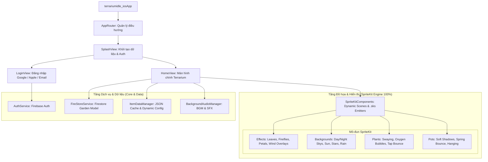
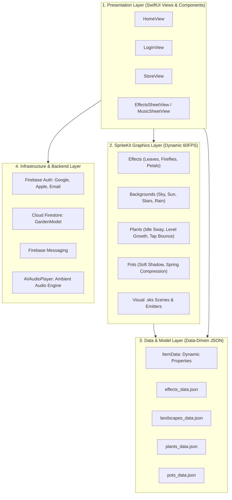
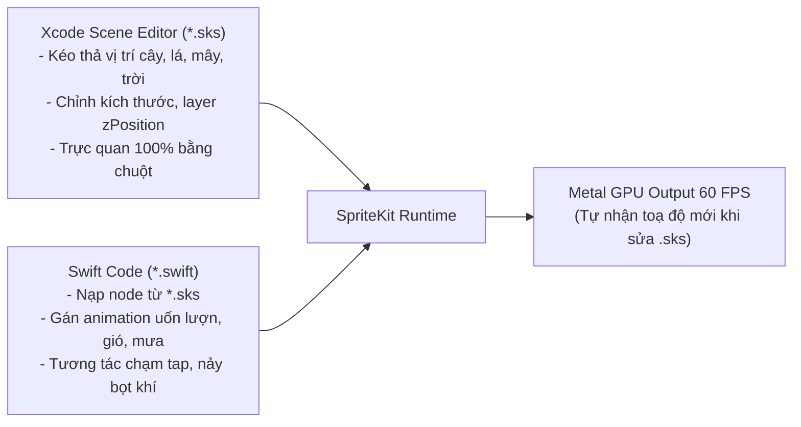
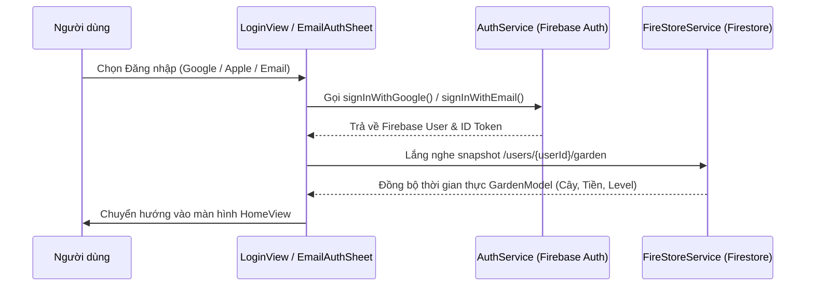

# 🌿 Terrarium Idle iOS

Dự án game mô phỏng thư giãn **Terrarium Idle** trên nền tảng iOS, xây dựng hoàn toàn bằng **SwiftUI**, **SpriteKit** và **Firebase**, kết hợp kiến trúc hướng thành phần (**Component-Driven**) và cơ chế cấu hình dữ liệu động (**Data-Driven Architecture**).

---

## 📑 Mục lục

1. [Tổng quan dự án](#-tổng-quan-dự-án)
2. [Sơ đồ kiến trúc phần mềm](#-sơ-đồ-kiến-trúc-phần-mềm)
3. [Cấu trúc thư mục mã nguồn](#-cấu-trúc-thư-mục-mã-nguồn)
4. [Hệ thống đồ họa SpriteKit](#-hệ-thống-đồ-họa-spritekit)
5. [Cơ chế cấu hình Data-Driven JSON](#-cơ-chế-cấu-hình-data-driven-json)
6. [Hệ thống Xác thực & Dữ liệu đám mây](#-hệ-thống-xác-thực--dữ-liệu-đám-mây)
7. [Hướng dẫn cài đặt & Biên dịch](#-hướng-dẫn-cài-đặt--biên-dịch)

---

## 📖 Tổng quan dự án

- **Nền tảng**: iOS 17.0+, iPhone & iPad
- **Ngôn ngữ**: Swift 5.10 / Swift 6 Compatible
- **Frameworks chính**:
  - `SwiftUI`: Giao diện người dùng Reactive, mượt mà.
  - `SpriteKit`: Hệ sinh thái đồ họa chính (100% thay thế Rive), phụ trách toàn bộ hiệu ứng lá rơi, đom đóm, mưa, cảnh nền trời/núi/mặt trời, chuyển động đung đưa & bong bóng oxy của cây, đổ bóng & nảy đàn hồi của chậu cây (60 FPS, Metal-accelerated).
  - `Firebase (Auth, Firestore, Messaging)`: Quản lý người dùng, đồng bộ dữ liệu khu vườn thời gian thực.
  - `AVFoundation`: Âm thanh nền (BGM), tiếng thời tiết (SFX) và hiệu ứng tương tác.
  - *(Lưu ý: Toàn bộ code Rive cũ đã được đóng comment lưu trữ lại trong thư mục `RiveCompoments` để làm tài liệu tham khảo, app không còn dùng Rive runtime nữa)*.

---

## 🏛️ Sơ đồ kiến trúc phần mềm

### 1. Sơ đồ luồng hoạt động tổng thể (System Workflow)



---

### 2. Sơ đồ phân tầng kiến trúc (Layered Architecture)



---

## 📁 Cấu trúc thư mục mã nguồn

```text
terrariumidle_ios/
├── Apps/
│   ├── Routers/
│   │   └── AppRouter.swift                  # Điều hướng các luồng màn hình chính
│   │
│   ├── Core/
│   │   ├── Services/
│   │   │   ├── AuthService.swift            # Xác thực Google, Apple, Email/Password
│   │   │   ├── AuthSession.swift            # Quản lý phiên đăng nhập
│   │   │   └── FireStoreService.swift       # Đồng bộ dữ liệu người dùng & khu vườn
│   │   ├── ViewModels/
│   │   │   ├── LoginViewModel.swift
│   │   │   └── AccountViewModel.swift
│   │   └── Utils/
│   │       ├── AudioPlayer.swift            # Phát âm thanh SFX
│   │       ├── BackgroundAudioManager.swift # Quản lý nhạc nền BGM luân chuyển
│   │       ├── MusicUnlockHelper.swift      # Kiểm tra mở khóa hiệu ứng/nhạc
│   │       └── FormatNumber.swift           # Định dạng số hiển thị tiền tệ
│   │
│   ├── Data/
│   │   ├── Models/
│   │   │   ├── ItemData.swift               # Model cấu hình động cho cây, chậu, effect, landscape
│   │   │   ├── GardenModel.swift            # Dữ liệu cây trồng, tiền tệ, cấp độ
│   │   │   └── UserModel.swift
│   │   └── Items/
│   │       ├── effects_data.json            # Cấu hình hiệu ứng lớp phủ (Overlays)
│   │       ├── landscapes_data.json         # Cấu hình bầu trời & phong cảnh (Landscapes)
│   │       ├── plants_data.json             # Danh sách cây cối & thuộc tính
│   │       ├── pots_data.json               # Danh sách chậu cây
│   │       ├── music_data.json              # Danh sách nhạc nền BGM
│   │       └── shop_items_data.json
│   │
│   ├── Compoments/
│   │   ├── SpriteKitComponents/             # ⭐️ Toàn bộ hệ thống đồ họa SpriteKit
│   │   │   ├── Effects/
│   │   │   │   ├── Leaves/                  # Lá rơi (Scene, View, FallingLeaves.sks)
│   │   │   │   ├── Fireflies/               # Đom đóm (Scene, View, Fireflies.sks)
│   │   │   │   └── Common/                  # OverlayEffectView, OverlayEffectConfig
│   │   │   ├── Backgrounds/
│   │   │   │   ├── Scenes/                  # SpriteKitBackgroundScene, BackgroundScene.sks
│   │   │   │   ├── Emitters/                # Rain.sks
│   │   │   │   └── Views/                   # SpriteKitBackgroundView
│   │   │   ├── Plants/
│   │   │   │   ├── Plant1/                  # 🌿 Cây Cỏ Loe ghép 18 lá (Plant1Node, Plant1View, Plant1Scene.sks)
│   │   │   │   ├── Scenes/                  # SpriteKitPlantScene, PlantScene.sks
│   │   │   │   └── Views/                   # SpriteKitPlantView
│   │   │   └── Pots/
│   │   │       ├── Scenes/                  # SpriteKitPotScene, PotScene.sks
│   │   │       └── Views/                   # SpriteKitPotView
│   │   │
│   │   ├── RiveCompoments/                  # Tích hợp RiveRuntime (.riv)
│   │   │   ├── RivePlantCompoment.swift
│   │   │   ├── RivePotCompoment.swift
│   │   │   └── RiveModel.swift
│   │   └── HomeCompoments/                  # Các giao diện con trang Home (SpeedDial, Sheets...)
│   │
│   └── Modules/
│       ├── Home/                            # Màn hình chính nuôi dưỡng Terrarium
│       ├── Auth/                            # Màn hình đăng nhập & Splash
│       └── Store/                           # Cửa hàng vật phẩm & trao đổi
│
└── Resources/
    ├── Rives/                               # File tài nguyên .riv cho background, cây, chậu
    ├── Images/                              # Ảnh minh họa
    └── Audio/                               # Nhạc nền & âm thanh hiệu ứng
```

---

## 🎨 Hệ thống đồ họa SpriteKit & Mô hình Kiến trúc Lai

Terrarium Idle áp dụng mô hình kiến trúc lai (**Hybrid Visual Architecture**): Kết hợp giữa **Visual Scene Editor (`*.sks`)** và **Swift Code (`*.swift`)**:

- **Kéo thả trực quan bằng chuột trong Xcode (`*.sks`)**: Thiết kế và căn chỉnh vị trí cây, lá, cuống, cành, mây, mặt trời, kích thước, góc xoay và thứ tự layer (`zPosition`).
- **Code Swift 100% cho Logic & Hoạt ảnh (`*.swift`)**: Đảm nhiệm mưa rơi, gió thổi, hiệu ứng lá uốn lượn mềm mại, cây lớn lên theo level, phản hồi vật lý khi chạm (`tap squash & stretch`), nhả bọt khí oxy `+O2`.
- **Tự động đồng bộ tọa độ**: Khi bạn kéo thả đổi vị trí hoặc xoay các bộ phận trong Xcode `.sks`, code Swift **tự động sử dụng vị trí mới đó**, không phải sửa lại tọa độ bằng tay trong code.
- **Xem trước độc lập (Isolated Preview)**: Xem trước giao diện tĩnh và toàn bộ chuyển động ngay trên **SwiftUI Canvas Preview** (ví dụ: `Plant1View.swift`) mà không cần chạy lại toàn bộ ứng dụng mỗi lần.



### Các module chính:

1. **Plants (Cây trồng đa trạng thái)**:
   - **File trực quan (`Plant1Scene.sks`)**: Chứa 3 nhóm node: `seedNode` (Hạt), `sproutNode` (Cây con), `matureNode` (18 lá cây trưởng thành `leaf_2`...`leaf_19`).
   - **Tự động uốn lượn**: Code Swift nạp 18 chiếc lá từ `.sks`, giữ nguyên vị trí được kéo thả và tự động gắn hiệu ứng uốn cong `startLeafBendingAnimation`.
   - **Quy ước Asset**:
     - `Asset-1` (`plant1_Asset-1`): Ảnh đại diện / đối chiếu tĩnh, không đưa vào scene diễn hoạt.
     - `Asset-2` -> `Asset-99`: Các thành phần hoạt ảnh động (lá cây, cành, hoa).
     - `Asset-100`: Gieo hạt (Level 1).
     - `Asset-200`: Cây con (Level 2).

2. **Effects (Lớp phủ chuyển động)**:
   - **Lá rơi & Cánh hoa**: Đung đưa trong gió (`swaying`), đổi góc nghiêng (`tilt`) và lật không gian 3D (`tumbling flip`).
   - **Đom đóm**: Chuyển động lượn lờ hữu cơ (`wandering`), hào quang phát sáng và thở nhịp (`pulsing alpha & scale`).
   - Cho phép truyền từ **1 đến 6 ảnh PNG tùy ý** hoặc tự sinh texture vector.
   - Luôn đặt `.allowsHitTesting(false)` để chạm xuyên qua đến các nút bấm và cây bên dưới.

3. **Backgrounds (Bầu trời động)**:
   - Tự động vẽ dải màu chuyển (`Gradient`) từ mảng mã màu Hex trong JSON.
   - Thêm các đối tượng động: Mặt trời, hoàng hôn, mây trôi tự nhiên theo gió, mặt trăng khuyết/tròn, bầu trời đầy sao lấp lánh, vệt sao băng, hạt mưa rơi tí tách.

4. **Pots (Chậu tương tác)**:
   - Chậu đổ bóng mềm, nảy lò xo khi nhấn (`spring compression`). Phản hồi đồng bộ cùng cây khi người chơi tap vào màn hình.
   - Hỗ trợ tham số `widthFill: 0.0 ... 1.0` giúp tinh chỉnh độ rộng chậu linh hoạt mà không làm biến dạng tỷ lệ tự nhiên.

5. **TerrariumSlot (Kiến trúc Slot Hợp nhất Cây & Chậu)**:
   - Gộp 2 `SKView` riêng rẽ (Cây + Chậu) trên màn hình chính thành 1 `TerrariumSlotView` / `TerrariumSlotScene` duy nhất, tiết kiệm 50% tài nguyên render Metal.
   - Phân tầng chiều sâu linh hoạt:
     - `z = 1`: Bóng đổ đáy chậu.
     - `z = 5`: Lòng đất & thành sau chậu.
     - `z = 10`: Mỏ neo cắm cây `plantMount` (cây nằm sau thành chậu với thuộc tính `"itemTypeAttribute": "none"`, các lá `z = 21..29 < potBody 50`).
     - `z = 50`: Thân & mặt trước chậu (`potBody`, che cuống và gốc cây).
     - `z = 70`: Cây rủ phủ ra trước mặt chậu (thuộc tính `"itemTypeAttribute": "front"`, các lá `z = 81..89 > potBody 50`).
     - `z = 100`: Dây treo trước chậu vắt qua lá.
     - `z = 200`: Hiệu ứng bọt khí Oxy bay lên.
   - Socket `plantMount` tự động neo gốc cây chính xác vào miệng chậu để bàn hoặc lòng bầu chậu treo.

---

## 📊 Cơ chế cấu hình Data-Driven JSON

Tất cả cấu hình được đưa về các file JSON trong `Apps/Data/Items/`, giúp lập trình viên hoặc Game Designer có thể thêm mới vật phẩm hoặc thay đổi hành vi hiển thị mà **không cần viết thêm bất kỳ câu lệnh `switch/case` nào trong mã nguồn Swift**:

### Ví dụ cấu hình trong `plants_data.json`:
```json
{
    "id": "plant13",
    "name": "Philodendron hederaceum",
    "description": "Loài cây dại, sức sống tốt, có hiệu quả lọc không khí",
    "image": "Philodendron-hederaceum@4.167x",
    "priceStore": 5700,
    "priceOxygen": 7500,
    "currencyUnit": "oxygen",
    "type": "plant",
    "effect": "Tiếng sóng biển - sfx6",
    "itemTypeAttribute": "front",
    "levelUnlock": 17
}
```
> **Thuộc tính `"itemTypeAttribute"` cho cây trồng:**
> - `"none"` (mặc định): Cây cắm trong chậu, thân nằm sau thành chậu (cắm vào `plantMount` `z = 10`, tổng z các lá `21..29 < potBody 50`).
> - `"front"`: Cây dây leo/thân rủ, cành lá vươn đè ra mặt trước chậu (`z = 70 > potBody 50`, ví dụ: `plant13`, `plant14`).
> - `"hanging"`: Cây thuộc dạng chậu treo chúc xuống.

### Ví dụ cấu hình trong `effects_data.json`:
```json
{
    "id": "overlay2",
    "name": "Lá rơi mùa thu",
    "image": "overlay2",
    "kind": "fallingLeaves",
    "wind": "breezeRight",
    "density": "medium",
    "speed": "normal",
    "images": [
        "leaf_autumn_1",
        "leaf_autumn_2",
        "leaf_autumn_3"
    ],
    "type": "overlay"
}
```

### Ví dụ cấu hình trong `landscapes_data.json`:
```json
{
    "id": "landscape3",
    "name": "Ban công mưa bão",
    "image": "sky_rain",
    "sksFile": "Rain.sks",
    "skyGradient": ["#47576B", "#738594", "#99A6B3"],
    "elements": ["clouds_dark", "rain"],
    "type": "landscape"
}
```

---

## 🔐 Hệ thống Xác thực & Dữ liệu đám mây



- **Google Sign-In**: Sử dụng Firebase `OAuthProvider(providerID: "google.com")` không phụ thuộc SDK ngoài cồng kềnh.
- **Apple Sign-In**: Tích hợp chuẩn Apple Authorization Services.
- **Email/Password**: Tích hợp sheet đăng nhập/đăng ký với đầy đủ validation và hiển thị lỗi thân thiện.
- **Cloud Firestore**: Tự động khôi phục vị trí cây, chậu, nhạc nền và cảnh quan khi đổi thiết bị.

---

## 🚀 Hướng dẫn cài đặt & Biên dịch

### Yêu cầu môi trường
- macOS 14.0+ (Sonoma) hoặc mới hơn
- Xcode 15.0+ (Khuyến nghị Xcode 16.0+)
- Command Line Tools cài đặt đầy đủ

### Các bước khởi chạy dự án:

1. **Clone repository**:
   ```bash
   git clone https://github.com/vqh2602/terrariumidle_ios.git
   cd terrariumidle_ios
   ```

2. **Cập nhật và giải quyết Package SPM**:
   ```bash
   xcodebuild -resolvePackageDependencies
   ```

3. **Biên dịch trên iOS Simulator**:
   ```bash
   xcodebuild -scheme terrariumidle_ios \
              -destination 'platform=iOS Simulator,name=iPhone 18 Pro' \
              build \
              CODE_SIGNING_ALLOWED=NO \
              CODE_SIGNING_REQUIRED=NO
   ```

4. **Mở dự án trong Xcode**:
   ```bash
   open terrariumidle_ios.xcodeproj
   ```
   Chọn simulator mong muốn và bấm `Cmd + R` để chạy ứng dụng.

---

### 👨‍💻 Tác giả & Đóng góp
Dự án được xây dựng và duy trì bởi **vqh2602**. Mọi thắc mắc và đóng góp xin vui lòng tạo issue hoặc pull request trên repository.
